<picture>
  <source media="(prefers-color-scheme: dark)" srcset="./svg/hero-dark.svg">
  
</picture>

I started in 2021 building mobile apps. In 2022 I trained my first models, on heart signals and sign language. Since late 2023 I've built language models that work in Kiswahili, cervical cancer screening support, risk models and computer vision that run every day, so I build the systems around the models too.

<picture>
  <source media="(prefers-color-scheme: dark)" srcset="./svg/timeline-dark.svg">
  
</picture>

## My work in machine learning

Most of the data I work with is scarce, messy, or doesn't look like the test. So I spend more time on how a model is checked than on squeezing the score.

### Listening for ships in a noisy sea

<a href="https://godsonntungi.github.io/#lab"><picture><source media="(prefers-color-scheme: dark)" srcset="./img/ships-dark.webp">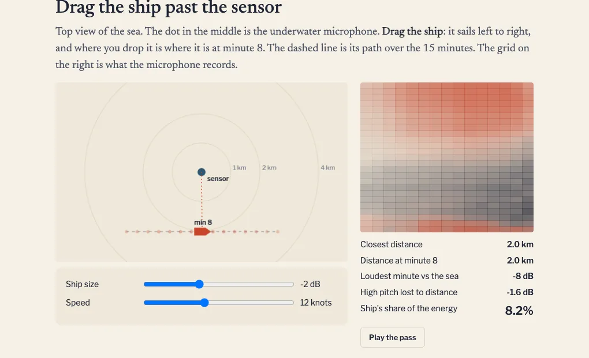</picture></a>

**[▶ Try it yourself](https://godsonntungi.github.io/#lab)**: drag the ship around the microphone and watch what it hears change.

Microphones on the South African seabed hear wind, waves, whales and ships all at once. The job is to say how much of each 15 minutes of sound is a ship. To understand the problem I built pages where you add a ship yourself and drag it past the microphone. They showed me where my points go: loud ships get under-guessed, and that one kind of window costs 65% of my lost points. My model scores 0.811; first place is 0.905.

### Forecasting water storage worldwide, one month ahead

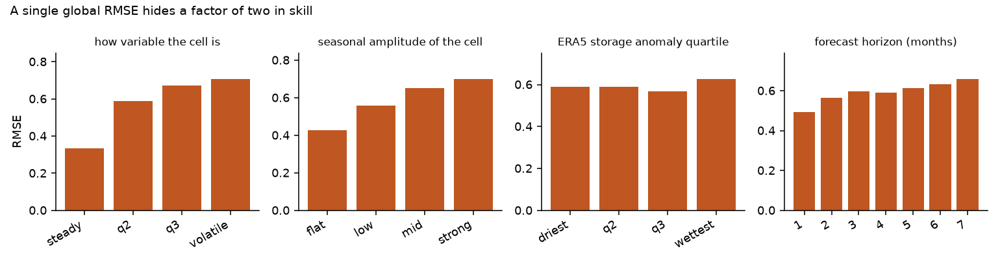

Water stored on land, measured from space by satellite gravity, month by month. I predict the change from last month instead of the level, with a per-cell seasonal model, four climate sources and a small tree correction on top. It cuts squared error by 32% against carrying the last value forward. Along the way I found and fixed a leak in my own pipeline, and showed that the features a model ranks highest can still hurt the forecast.

### Validating the way the test is built

<picture>
  <source media="(prefers-color-scheme: dark)" srcset="./svg/grouped-dark.svg">
  
</picture>

Predicting whether a recorded death was climate-sensitive. Train and test turned out to come from different villages (a classifier tells them apart perfectly), so a random split would flatter the model. I validated by whole village, dropped raw coordinates that only memorised places, and picked final models across about 150 seeds. Cross-validation 0.830, leaderboard 0.839.

### Spotting a supernova in its first 10 days

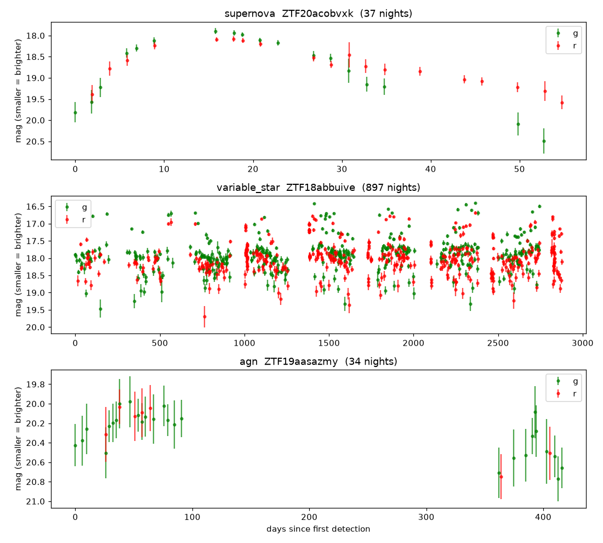

Sorting sky alerts into supernova, variable star or active galaxy from brightness over time. With the full history it scores 0.98; from only the first 10 days it still reaches 0.95, early enough to point a telescope.

## My work in computer vision

I started with a YOLO traffic tracker in 2023. Today my vision models run on small computers at real gates, where the internet drops and the light changes all day.

### Segmenting traffic in Dar es Salaam

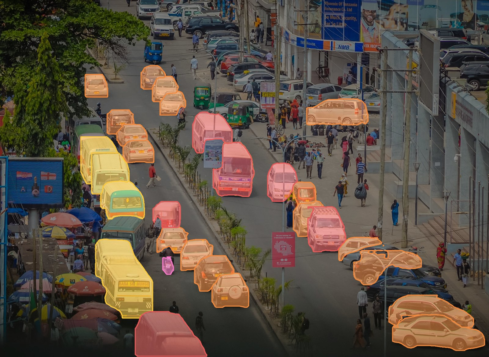

Instance segmentation with YOLO11 on a busy Dar street: 30 vehicles outlined. It also shows the gap: the stock model has no class for bajajis, so it skips them. That's why I fine-tune on local footage.

Photo: Erasmus Kamugisha, CC BY-SA 4.0, via Wikimedia Commons. Masks added by me; this image is shared under the same licence.

### Vision at the gate, on the edge

<picture>
  <source media="(prefers-color-scheme: dark)" srcset="./svg/gate-dark.svg">
  
</picture>

A plate detector watching at 30 frames a second triggers a snapshot from every camera. Plate reading, head counting and matching the same vehicle across cameras then all run on one small edge computer, 200 to 350 ms end to end, and it keeps working offline. Training on local footage took detection accuracy (mAP50) from 0.55 to 0.79. Measured in the field: the passenger count is exact 52% of the time and within one 90% of the time, so I'm still working on crowded cars.

### Cervical cancer screening support

Cervical cancer is one of the biggest cancer killers of women in Tanzania, and clinics screen with a quick visual test (VIA). My innovation: the AI judges whether each clinic photo is good enough before it judges the cervix, so a blurry or glary shot gets retaken instead of misread, and then it marks possible lesions to guide the nurse. It's an aid; an expert still reads every case.

### Fingerprints from a phone camera

<picture>
  <source media="(prefers-color-scheme: dark)" srcset="./svg/finger-dark.svg">
  
</picture>

Checking a fingerprint with an ordinary phone camera, no scanner. My innovation: matching on both the overall ridge texture (DINOv2 features) and the geometry of the ridge points, which cut wrong-person matches from 10.7% to 3.3%. A popular ridge filter made it seven times worse, so it's out.

### From paper ECGs back to heart signals

<picture>
  <source media="(prefers-color-scheme: dark)" srcset="./svg/ecg-dark.svg">
  
</picture>

My first model, in 2022, read heart signals. Now I'm working on the step before that: most ECGs in Tanzania exist only on paper, so I'm studying how to turn a photo of a printout back into the signal. I built a data explorer over public PTB-XL records and paper images I generated from them.

### Camera and radar, together

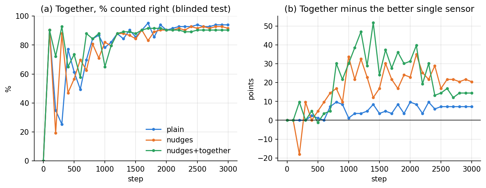

Counting people with a camera and a mmWave radar together. A frozen image encoder and a radar point encoder meet through attention, and training randomly blinds one sensor so the other learns to cover. On a test with the camera blinded, the pair beats the better single sensor by 7 to 21 points. Trained on a public dataset.

## My work in language models

I fine-tune and serve open models myself, on rented GPUs, and I care about Kiswahili working as well as English.

### Reading 200-year-old handwriting

<picture>
  <source media="(prefers-color-scheme: dark)" srcset="./svg/handwriting-dark.svg">
  
</picture>

Handwritten property deeds from the 1700s and 1800s. A LoRA fine-tune of a 7B vision-language model took character error from 49% to 5.25%, and a word-by-word vote across three fine-tunes gave my best leaderboard score, 0.898.

### Fine-tuning and serving with vLLM

<picture>
  <source media="(prefers-color-scheme: dark)" srcset="./svg/finetune-dark.svg">
  
</picture>

Supervised fine-tuning with LoRA, then GRPO with a reward on the answers, on Qwen2.5 models from 1.5B to 14B. Since 2025 my fine-tuned models are served with vLLM, which batches many requests on one GPU.

### Kiswahili search that cites its source

<picture>
  <source media="(prefers-color-scheme: dark)" srcset="./svg/rag-dark.svg">
  
</picture>

Questions in Kiswahili or English over long company reports. Meaning search and word search run side by side and take turns in the results, with Kiswahili money words mapped so the word search finds them. Every answer cites the page, and a fixed set of test questions runs on every change.

### One agent, many tool servers

<picture>
  <source media="(prefers-color-scheme: dark)" srcset="./svg/agent-dark.svg">
  
</picture>

An assistant for an insurance business on web, WhatsApp and SMS. One tool-calling agent, no router. Each business area is its own MCP server, and fixed lookups are resources rather than tools, which keeps it at about 24 tools under a budget of 40.

## My work in data

Before any model, the data has to be right. These are pipelines and audits where getting the data right was the whole job.

### Auditing a road-coverage score, to 7 decimal places

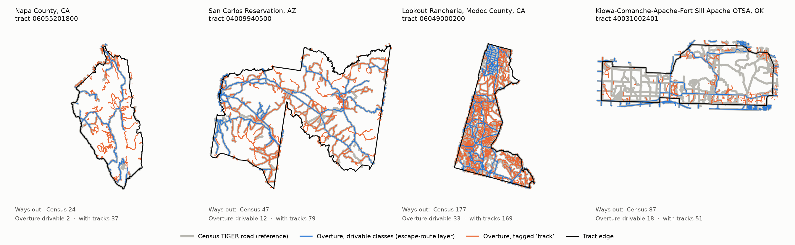

I rebuilt a hidden scoring pipeline for 9,379 US census tracts from 5 GB of map data and matched it to within 0.0000005, by clipping in DuckDB in the same projection as the reference. Then I measured what the score misses: 19% of real ways out of rural tracts are hidden from the escape-route map, against 4% for urban ones.

### Flood and landslide risk for Tanzania

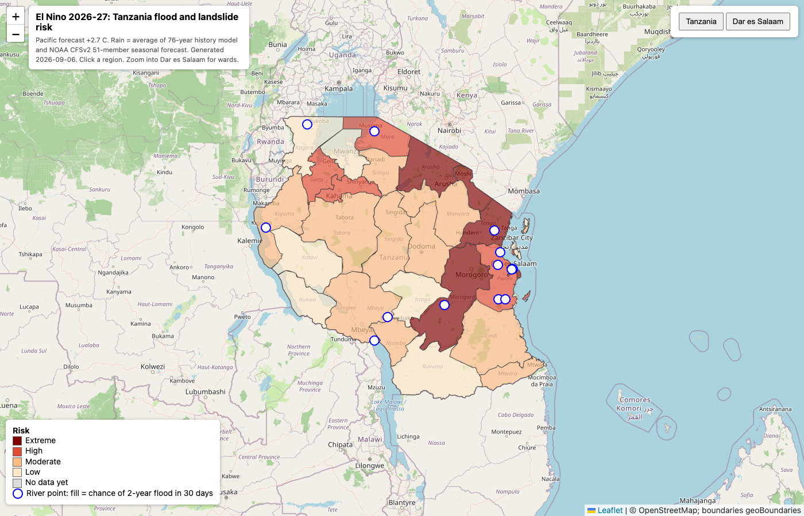

76 years of rainfall history combined with a 51-member seasonal forecast, scored per region and per Dar es Salaam ward. River points show the chance of a 2-year flood in the next 30 days.

### Pulling four climate datasets onto one grid

<picture>
  <source media="(prefers-color-scheme: dark)" srcset="./svg/satellite-dark.svg">
  
</picture>

ERA5-Land, GLDAS, FLDAS and IMERG come in different grids, units and calendars. I pull them through Earth Engine and align them on one monthly 1-degree land grid, so every model reads one table.

### A scraper that stores nothing twice

<picture>
  <source media="(prefers-color-scheme: dark)" srcset="./svg/scraper-dark.svg">
  
</picture>

The stock-exchange site sends no "changed since" headers, so I fingerprint the parsed items instead. If nothing changed, nothing is written. It follows the site's robots rules.

## My work in software

A model only matters if the system around it holds up. I build those systems too, mostly in Go, Rust and Python.

### Realtime chat on Postgres alone

<picture>
  <source media="(prefers-color-scheme: dark)" srcset="./svg/chat-dark.svg">
  
</picture>

Many Go servers share live chat through Postgres alone, with no Redis and no message broker. A dropped phone reconnects and gets up to 500 missed messages back. Load-tested until it broke: 1,107 people online, 95% of reads in 12 ms.

### Meeting audio that never drops

<picture>
  <source media="(prefers-color-scheme: dark)" srcset="./svg/audio-dark.svg">
  
</picture>

Live audio streams from the phone to speech-to-text, sentence by sentence. When the speech service is full, the server keeps the audio and catches up later, so no meeting is turned away. Uploads resume from the last byte, and a restarted server picks the meeting back up.

### Python to Rust, proven identical

<picture>
  <source media="(prefers-color-scheme: dark)" srcset="./svg/rust-dark.svg">
  
</picture>

I rewrote a media server from Python to Rust, then proved nothing changed: all 2,295 recorded responses came back byte-identical, and all 868 file names parsed the same. It now runs on an old phone in 7 MB of memory.

### Offline sync engine

<picture>
  <source media="(prefers-color-scheme: dark)" srcset="./svg/sync-dark.svg">
  
</picture>

Every record is saved on the phone first, so the app works with no internet. When it's back, the phone pushes what's unsent, then pulls everything after the last number it saw. The server numbers every change in order, so nothing is missed.

---

31 models on [Hugging Face](https://huggingface.co/GodsonNtungi) · [godsonntungi.github.io](https://godsonntungi.github.io)
